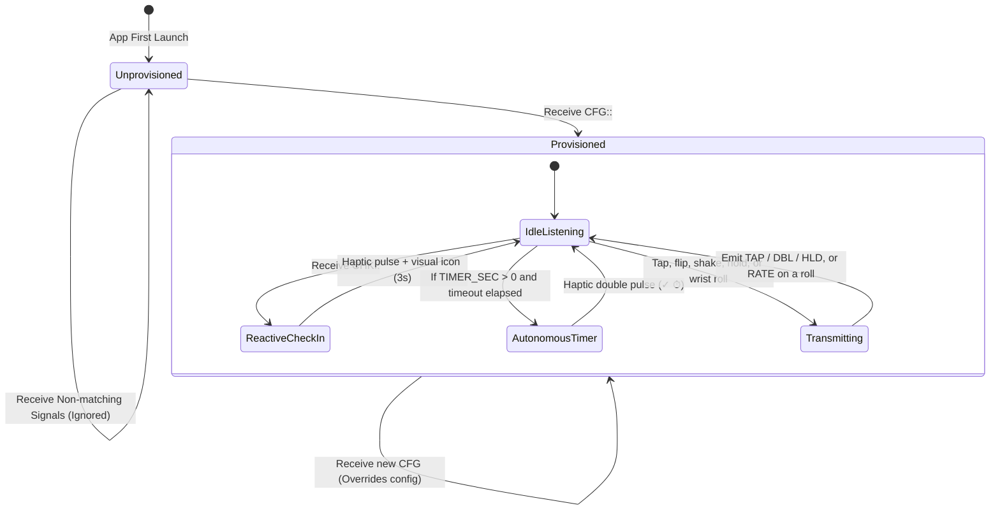

# GibberLink Protocol & Provisioning Specification
**Target Systems:** GibberWear (Wear OS Smartwatch) $\leftrightarrow$ Muse (Companion App / Web Client)  
**Document Version:** 1.1  
**Status:** Aligned with the GibberWear watch, 2026-11-15  

---

## 1. Executive Summary & Objectives

The goal of this revision is to transition **GibberWear** from an un-attributed, broadcast-only utility into a **bi-directionally provisionable, multi-tenant wearable terminal**.

### Key System Principles:
1. **Primary Transport:** **GibberLink (Acoustic / GGWave Ultrasound)** is the primary communication channel.
2. **Fallback Transport:** **Bluetooth Low Energy (BLE)** mirrors all GibberLink protocol formats 1:1.
3. **No Hardcoded Autonomous Defaults:** The watch must **not** default to an autonomous 5-minute reminder loop. Check-in reminders are primarily initiated remotely by Muse, or governed by explicitly provisioned local timer intervals.
4. **Attributed Telemetry:** All telemetry emitted by the watch must carry a provisioned **User Identifier (`UID`)** so Muse can distinguish multiple senders in the same acoustic space.
5. **On-Watch Provisioning:** The watch receives its `UID`, display name, and operational timer parameters via a setup handshake over GibberLink or BLE.
6. **Addressed commands:** Every Muse → watch command carries an address: the provisioned profile key, or `ALL`. A command with no address is ignored. Treating a missing key as a broadcast is deprecated.

---

## 2. Message Format & Protocol Payloads

Acoustic ultrasound transmission via GGWave (Fast Ultrasound protocol, 48 kHz mono) operates with limited payload bandwidth (typically 8–16 bytes per burst). All payloads must remain compact, ASCII-encoded, and delimiter-separated (`:`).

### A. Telemetry Payloads (Watch $\rightarrow$ Muse)

All transmissions from the watch must prepend the provisioned `UID`.

#### 1. Instant Touch & Motion Gestures
Format: `<UID>:<GESTURE>`

| Gesture Trigger | Payload Example (`UID=J1`) | Meaning |
| :--- | :--- | :--- |
| **Tap** (Center touch or wrist flip) | `J1:TAP` | Green — all good |
| **Double Tap** (Center or shake) | `J1:DBL` | Yellow — caution / mixed |
| **Hold** (Long press or vigorous shake) | `J1:HLD` | Red — stop |

#### 2. Rating commit (wrist roll)

Taps, drags, and crown turns only edit a draft on the watch. The draft is sent once, on a deliberate wrist roll.

Format: `RATE:<UID>:<TOPIC_ID>:<VALUES>:<TIMESTAMP_MS>`

- `<VALUES>` is a comma-separated list, one integer per pole of the widget on screen, pole 0 first.
- One ring, two rings, three rings, and the switchbox (`W2`) use `-100..+100`.
- The triad simplex (`W3`) and the radar widgets (`W4` through `W8`) use `0..100`.
- `<TOPIC_ID>` is the topic from the last `PROG`. Swiping to another widget on the watch itself uses the placeholder `debug-widget-cycle`.

Three-ring example (enjoyment, heat, endurance):

```text
RATE:eve:top-kink-impact:80,60,-20:1731638415200
```

Those three poles are not sent as separate `E` / `H` / `N` chirps on each crown detent.

#### 3. Compact ultrasound form of the same commit

```text
R:<UID>:<HASH4>:<HEX_VALUES>
```

- `<HASH4>` is the low 16 bits of FNV-1a over `<TOPIC_ID>`, four uppercase hex characters.
- Each pole is one hex nibble (`0`..`F`).
- On a `0..100` widget, `0` is nibble `0` and `100` is nibble `F`.
- On a `-100..+100` widget, `-100` is nibble `0`, `0` is nibble `8`, and `+100` is nibble `F`.

The `RATE` line goes out over BLE and is also played as an ultrasound chirp. `ACK:<key>:CFG` is played the same way: GGWave protocol `p=4` (ultrasound fast), 48 kHz mono, encode volume 70. The microphone is paused while the chirp plays, then listening starts again.

---

### B. Remote Control & Check-In Signals (Muse $\rightarrow$ Watch)

Muse sends signals to initiate physical check-ins on the wearer.

Format: `CHK:<TARGET_UID>:<TYPE>`

| Field | Values | Description |
| :--- | :--- | :--- |
| `TARGET_UID` | Alphanumeric (e.g. `J1`, `01`, `ALL`) | Only the matching watch responds (`ALL` for broadcast). |
| `TYPE` | `P` (Pulse) | Single gentle haptic vibration pulse (150ms) + display `✓ ♥`. |
| `TYPE` | `T` (Timer) | Double haptic vibration pulse (100ms / 100ms) + display `✓ ⏱`. |

*Examples:*
- `CHK:J1:P` $\rightarrow$ Watch `J1` vibrates once with heart symbol.
- `CHK:J1:T` $\rightarrow$ Watch `J1` vibrates twice with timer symbol.
- `CHK:ALL:T` $\rightarrow$ All nearby provisioned watches trigger double check-in.

### C. Low Power Mode Toggle (Muse $\rightarrow$ Watch)

To aggressively preserve battery life, Muse can disable the watch's microphone and ultrasound decoding engine when a reliable BLE link is present.

Format: `LPM:<TARGET>:<STATE>`

| Field | Values | Description |
| :--- | :--- | :--- |
| `<TARGET>` | Profile key or `ALL` | Only the matching watch responds (`ALL` for every watch). A missing target is ignored. |
| `<STATE>` | `1` or `ON` | Enable Low Power Mode. If BLE is connected, ultrasound listening stops immediately. |
| `<STATE>` | `0` or `OFF`| Disable Low Power Mode. Ultrasound listening resumes (always on). |

The older unkeyed form `LPM:1` / `LPM:ON` is ignored.

*Behavior:* The watch persists this state. If low power mode is on and the BLE link drops, the ultrasound engine restarts so the acoustic channel can still deliver.

---

### D. Rating prompt (Muse $\rightarrow$ Watch)

Format: `PROG:<TARGET_UID>:<TOPIC_ID>:<WIDGET>:<TIMEOUT_SEC>`

The watch shows `<WIDGET>`, stores `<TOPIC_ID>` for the next wrist roll, and clears the draft. `<TARGET_UID>` must be `ALL` or the provisioned key. `<TIMEOUT_SEC>` is accepted and not yet used to dismiss the widget.

| Widget code | Layout |
| :--- | :--- |
| `W1`, `R1`, `W1X1` | 1 concentric ring |
| `W1X2`, `R2` | 2 concentric rings |
| `W1X3`, `R3` | 3 concentric rings (enjoyment, heat, endurance) |
| `W2` | Split switchbox |
| `W3` | Barycentric triad |
| `W4` .. `W8` | Tetrad, pentad, hexad, heptad, octad |

*Example:* `PROG:eve:top-dietary-heptad:W7:90`

### E. Device Provisioning / Programming Setup (Muse $\rightarrow$ Watch)

Used during initial onboarding or pairing to configure the watch without physical UI entry.

Muse sends this today:

```text
CFG:<KEY>:<TIMER_SEC>
```

Also accepted, when the middle field is not an integer:

```text
CFG:<KEY>:<DISPLAY_NAME>:<TIMER_SEC>
```

| Parameter | Type / Constraints | Description |
| :--- | :--- | :--- |
| `<KEY>` | Short ASCII key | Profile key the watch puts on every outgoing payload (e.g. `eve`, `adam`). |
| `<DISPLAY_NAME>` | Optional ASCII | Accepted in the longer form. Not shown on the watch yet. |
| `<TIMER_SEC>` | Integer (seconds) | **`0`** disables the local reminder.<br>**`> 0`** is the reminder interval (e.g. `300` = 5 min). |

*Examples:*
- `CFG:eve:300` $\rightarrow$ Key `eve`, 5-minute local reminder.
- `CFG:eve:0` $\rightarrow$ Key `eve`, reminders only when Muse sends `CHK`.
- `CFG:J1:Jason:0` $\rightarrow$ Key `J1`, timer off. `Jason` is ignored until the face shows a display name.
- `CFG:ALL:300` $\rightarrow$ Every watch sets its timer to 300 seconds and keeps its own key. Each watch answers `ACK:<its key>:CFG`.
- `CFG:300` or `CFG:` with no key is ignored.

#### Provisioning Handshake Acknowledgment (Watch $\rightarrow$ Muse)
When the watch successfully parses and persists the `CFG` message, it immediately emits:
```text
ACK:<UID>:CFG
```
*(e.g., `ACK:J1:CFG`)*, allowing Muse to confirm that programming succeeded.

#### Heat sync (Muse $\rightarrow$ Watch)
After the heat-popover setup is confirmed, Muse sends the profile's current heat about 1.5 seconds later:

```text
HEAT:<KEY>:<VALUE>
```

`<VALUE>` is an integer from −100 to +100. The watch sets the heat ring (pole 1 on W1x2 and W1x3) and keeps that value across restarts. It does not transmit a rating or an ACK. `<KEY>` must be `ALL` or the provisioned profile key. A missing key is ignored.

*Example:* `HEAT:eve:40`

---

## 3. Watch Runtime Behavior & State Machine



### Persistence
- Configuration parameters (`UID`, `displayName`, `timerSec`) must be stored in on-device persistent storage (`SharedPreferences` or `EncryptedSharedPreferences`).
- App cold-starts retain the last provisioned configuration.

---

## 4. Multi-Channel Transport Architecture

### Channel 1: GibberLink Ultrasound (Primary)
- **Protocol:** GGWave Audio (Fast Ultrasound mode, center carrier frequency ~18–20 kHz).
- **Sampling Rate:** 48 kHz mono.
- **Hardware Requirements:**
  - Watch Speaker for transmission.
  - Watch Microphone (`android.permission.RECORD_AUDIO`) active in foreground for listening.

### Channel 2: Bluetooth Low Energy (Fallback & Redundancy)
- **Service UUID:** `0000FFF0-0000-1000-8000-00805F9B34FB` (GibberLink BLE Service)
- **Characteristics:**
  - **Telemetry TX (Notify):** Emits outgoing attributed payloads (`eve:TAP`, `RATE:eve:...`).
  - **Control RX (Write):** Accepts incoming commands (`CFG:...`, `CHK:...`, `LPM:...`, `PROG:...`, `HEAT:...`).
- Payload parsing logic is identical between GibberLink and BLE.

---

## 5. Coordination & Alignment Checklist for Muse

Before finalizing implementation, please confirm the following protocol details:

1. [ ] **UID Character Set & Length:** Confirm whether `1–4` alphanumeric characters (e.g. `[A-Za-z0-9]{1,4}`) is sufficient for your database schema.
2. [ ] **Display Name Length:** Confirm maximum length (recommended: max 8–10 characters to fit cleanly above Wear OS dial rings).
3. [ ] **Acoustic Synthesis on Watch:** 
   - *Option A (Recommended):* Embed GGWave native C++ library via NDK on the watch to synthesize dynamic `<UID>:...` WAV audio in real time.
   - *Option B:* Muse sends pre-computed sound tokens or restricts UIDs to a fixed static table.
4. [ ] **Microphone Duty-Cycle:** Does Muse expect the watch to continuously listen in the foreground, or only during active sessions / pairing modes to preserve watch battery?
5. [x] **Confirmation Handshake:** The watch sends `ACK:<key>:CFG` over ultrasound and BLE after it saves a `CFG` message.
